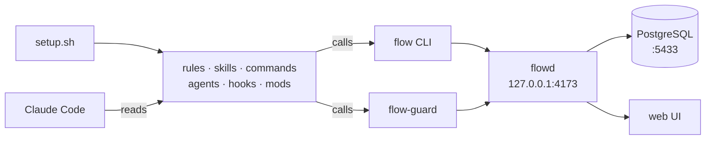
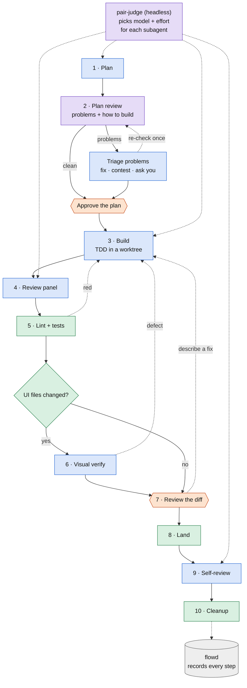

# agents

Portable agent configuration for Claude Code: the **flow** pipeline (plan → implement → review →
land), its slash commands and skills, always-on rules, hooks, and a stats service that records every
run.

**This repository is the source of truth — edit here, then run `./setup.sh global`.** Nothing is
synced back from a project checkout.

## Quick start

```bash
./setup.sh global                                          # install into ~/.claude
go install github.com/tweety53/spectre/cmd/spectre@latest  # needed by every skill but /flow-plan
cd stats && docker compose up -d && make build              # flowd + flow CLI
```

1. In Claude Code: `/plugin install prime-radiant-inc/superpowers`.
2. Paste the hook snippet the installer prints into `~/.claude/settings.json` (hooks are installed,
   never registered for you).
3. In any project: `/flow <name>`.

**Never stop the live daemon or drop the `flow` database:** every project's runs write to it.
`stats/README.md` covers the launchd agent, the UI-test stack and Jira credentials.

Per project: `/path/to/agents/setup.sh claude-code` links skills, commands and agents into `.claude/`
and renders the opt-in rules a project names under `## standards` in its `.flow/project.md`.

## How it fits together



`setup.sh` installs, the harness reads, and every check and record goes through `flowd`.

## How a change really flows

Orange boxes are your decisions, blue are agents, purple are one-shot read-only model calls
("headless"), green are guards: code whose exit code decides.



## The good parts

- **The plan is read cold.** The finished plan is reviewed by a model that never saw
  the conversation, which also decides how the work is split and reviewed.
  [Planning](docs/planning.md)
- **A review panel picked per change.** Up to seven reviewers, each with one job; the plan review
  picks only those the change gives something to read, and a documentation change gets one.
  [Review panel](docs/review-panel.md)
- **Every agent has a role, and each role its own models.** You list the model and effort pairs a
  role may run on; a small judge call picks one for each task, so cheap work runs on a cheap model.
  [Roles and models](docs/roles-and-models.md)
- **Visual verify.** When a change touches the UI, an agent runs the app, screenshots it and compares
  each screen with the mockup, side by side; a difference sends the change back to be fixed.
  [Visual verify](docs/visual-verify.md)
- **Each change works in its own space.** Its own git worktree, and where the project declares it,
  its own database, storage bucket and ports, so two changes can run at once without touching each
  other or your main checkout. [Isolation](docs/isolation.md)
- **Guards decide, not agents.** Every check that matters is tested code whose exit code is the
  verdict; nothing rests on an agent saying it behaved. [Guards and hooks](docs/guards.md)
- **A dashboard of every run.** State, cost, time, reviewers and guard results for every change, in a
  local web page. [Dashboard](docs/dashboard.md)
- **Self-review after every change.** Once a change lands, the pipeline reviews its own run: what
  went wrong, what went well, and which instruction would have saved a fix round. Small fixes to the
  tooling land by themselves. [Self-review](docs/self-review.md)
- **The pipeline repairs itself mid-run.** A run that hits a defect in the flow tooling fixes it,
  tests it and carries on instead of stopping to ask.
  [Self-review](docs/self-review.md#fixes-made-mid-run)
- **A conversational mode.** `/flow-interactive` takes one request at a time; each is implemented,
  checked and landed before the next. [/flow-interactive](docs/flow-interactive.md)

## Commands

`<name>` is optional everywhere: with one open change it is picked, otherwise you are asked. No
command takes a flag.

| Command | What it does |
|---------|--------------|
| `/flow <name>` | The whole pipeline, one command, re-entrant |
| `/flow-fast <name>` | Lighter: worktree, decided panel, lint and targeted tests, default landing route. No spectre artifacts |
| `/flow-interactive [key or name]` | A conversational session: each request is implemented, verified and landed on its own; an explicit stop self-reviews and cleans up |
| `/flow-plan` | Thinking-partner mode, no implementation; a captured session creates the change at `STARTED` |
| `/flow-learn-quiz` | Teacher mode: quizzes you on a change |

## The pipeline in three states

| State | What happens | Your gate |
|-------|--------------|-----------|
| `STARTED` | Brainstorm, you answer every ambiguity and approve the design, then spectre artifacts and `tasks.md` | `/clear`, then `/flow <name>` |
| `IN_PROGRESS` | Implement in a worktree (TDD per task), review panel, lint and tests, staged diff | Review the diff. Describe a fix and `/flow` re-runs without moving the state; "looks good" and a bare `/flow` lands it |
| `FINISHED` | Cleanup: verify the merge, save to flowd, remove worktrees and branches, issue to Done | none |

- **The gate is the state.** No command exists just to record that you reviewed something.
- **Landing** follows the project's `## default landing route`: open a PR, merge and push, or manual.
- **A plan check** (`flow-guard plan-check`) reads the plan cold and decides the implementer groups,
  review panel and visual verification; nothing in a project configures them.

Canonical: `skills/flow-contracts/pipeline.md` (state machine), `finish-contract-run1.md` and
`finish-contract-run2.md` (landing and cleanup). The skill map is `skills/README.md`.

### The steps a run marks

Every step a run marks in `flowd`, by key. `stats/internal/stages/names_test.go` parses this table and
fails if it drifts from the code, so edit both together. Which phase
file marks each key is **Stage keys** (`skills/flow/stage-keys.md`).

| Key | Name |
|-----|------|
| `flow.plan` | Plan — kickoff to the plan gate |
| `flow.implement` | Implement |
| `flow.review` | Review |
| `flow.verify` | Verify: workspace isolation, lint and test |
| `flow.land` | Land |
| `flow.self-review` | Run the self-review pass (run 1) |
| `flow.pipeline-fix` | Pipeline fix — a fix to the flow tooling a run makes |
| `flow.cleanup` | Cleanup (run 2) ▸ |
| `plan.session` | Plan session — `/flow-plan` research up to a capture's kickoff |

▸ marks a stage with substructure; its procedure lives in the phase file under `skills/flow/`.

## What is where

| Path | Holds |
|------|-------|
| `skills/` | The `/flow*` skills; `flow-contracts/` holds the on-demand contracts |
| `commands-claude/` | Slash-command wrappers. Required: without them `/flow` is an unknown command |
| `rules/` | Rules (always-on by their own `alwaysApply`) and `agent-baseline.md` for subagents |
| `agents/` | Subagent types `flow-{low,medium,high,xhigh}` and `flow-planner-*` |
| `hooks/` | The Python hooks |
| `stats/` | `flowd`, the `flow` CLI, every guard (`internal/guard/`) and the web UI (`web/`) |
| `scripts/` | `flow-guard`, the bootstrap that builds and runs every guard |
| `mods/` | Claude Code plugins, e.g. `flow-task-list` |
| `docs/` | The detail pages linked above, `briefs/` (lessons) and `designs/` (records of earlier changes) |
| `.flow/project.md` | This repository's own flow config: lint, test, run, stop |
| `setup.sh` | The installer |

## Developing this repository

From `stats/`: `gofmt -w .`, `go vet ./...`, and `cd web && npx tsc -b` must exit clean. Guard tests:
`go test ./internal/guard/...`. The full lint list is `.flow/project.md`'s `## lint`. After a change
lands, run `./setup.sh global` and `make -C stats restart` so the next run uses it. Edits to existing
skills, commands and hooks are live (symlinks); an always-on rule needs the re-run.
