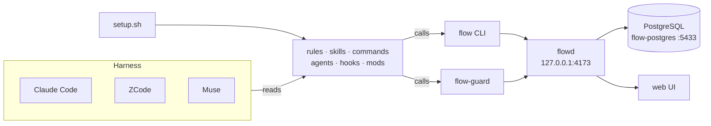
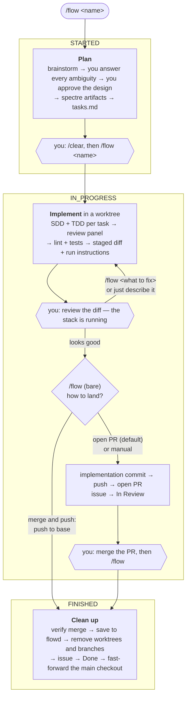

# agents

Portable, project-agnostic agent configuration: the **flow** pipeline (spectre + Superpowers), its
skills and slash commands, always-on rules, hooks, and the stats service that records every run.

**This repository is the source of truth — edit here, run `./setup.sh global`.** Nothing is ever
synced *into* this repo from a project checkout.

---

## Quick start

```bash
./setup.sh global                                          # install into every harness
go install github.com/tweety53/spectre/cmd/spectre@latest  # needed by every skill but /flow-plan
cd stats && docker compose up -d && make build              # flowd + flow CLI (see Stats app)
```

- In Claude Code, install Superpowers: `/plugin install prime-radiant-inc/superpowers`.
- Register the hooks the installer prints into `~/.claude/settings.json`, then type `/flow <name>`
  in any project.

---

## Architecture

**`setup.sh` installs; the harness reads; every check and record goes through `flowd`.**



---

## Repository layout

```text
.
├── .flow/            this repository's own flow config (project.md: lint, test, run, stop)
├── agents/           subagent definitions: flow-{low,medium,high,xhigh}, flow-planner-{low,medium,high,xhigh}
├── commands-claude/  thin slash-command wrappers for Claude Code and ZCode
├── docs/             briefs/ (lessons), designs/ (the design record run 1 writes per /flow change) and prompt-tuning/ (/flow-prompt-tuning inbox + LEDGER.md)
├── hooks/            the Python hooks (see Guardrails)
├── mods/             Claude Code plugins: flow-task-list (the task band above the prompt)
├── rules/            rules (alwaysApply in each frontmatter) + agent-baseline.md, the subagent baseline
├── scripts/          flow-guard, the bootstrap that builds and runs every guard
├── skills/           the /flow* skills; flow-contracts/ holds the on-demand contracts (map: skills/README.md)
├── spectre/          peers (cross-repo links); changes/ is gitignored, per change
├── stats/            flowd, the flow CLI, every guard (internal/guard/) and the web UI (web/)
├── templates/        CLAUDE.md and AGENTS.md copied into a project that lacks one
├── setup.sh          the installer
├── CLAUDE.md         this repository's instructions (Claude Code)
└── AGENTS.md         the same, for ZCode and Muse
```

- **`rules/`:** whether a rule is always-on is its own `alwaysApply`; opt-in rules (e.g. the Kotlin
  backend standard) reach only projects that name them.
- **`skills/flow-contracts/pipeline.md`** is canonical for the state machine.
- **`mods/flow-task-list`** shows the main agent's unit, each running subagent as `Task <x>/<n>`,
  and the plan's pending tasks; its hint line adds the tracker key, phase and done/total count.

---

## Commands

**`<name>` is optional everywhere** — with one open change it is picked, otherwise you are asked.
No command takes a flag.

| Command | What it does |
|---------|--------------|
| `/flow <name>` | The whole pipeline, one command, re-entrant — see below |
| `/flow-fast <name>` | Lighter: worktree, class-decided implementation and panel, lint + targeted tests, default landing route, cleanup. No spectre artifacts or state file |
| `/flow-interactive [key or name]` | Conversational session: each request is implemented inline, verified, landed by merge and push (`flow interactive land`); an explicit stop self-reviews, cleans up and finishes |
| `/flow-plan` | Thinking-partner mode, no implementation; a captured session creates the change at `STARTED` |
| `/flow-status [name]` | Read-only report of every open change |
| `/flow-settings` | Global reviewer slots |
| `/flow-self-review <name>` | Runs the self-review pass an older run deferred |
| `/flow-prompt-tuning` | Applies saved implementer/reviewer prompt updates after an A/B replay proves each; logs to `docs/prompt-tuning/LEDGER.md` |
| `/flow-experiment-close` | Closes an allowed-pairs experiment from its stored stats with a verdict; a positive one starts the `/flow` change that makes it permanent |
| `/flow-learn-quiz` | Teacher mode: has you restate a change and quizzes you until you understand it |
| `/call-efficiency-audit` | Measures a running dev stack's repeated reads, repeated queries and per-item queries |

## How the pipeline works

Three states. Every arrow into a box is a `/flow` invocation, and every hexagon is a gate that is
yours.



- **The gate is the state.** No command exists just to record that you reviewed something.
- **A fix never moves the state.** Re-run `/flow` with instructions, or describe the problem in the
  same session.
- **Merge status alone decides** whether a bare `/flow` integrates or cleans up.
- **Run 2 runs no tests or linters** and commits nothing: it saves `tasks.md` and the self-review
  bundle to flowd, then removes the worktrees.
- **The plan is read cold before it is implemented.** On a change that is not trivial, a fresh
  reviewer reads the artifacts — and nothing of the conversation — twice, each time in the stage
  `flow.plan-review`: once `proposal.md` and `design.md` are written, and once `tasks.md` is
  planned, before `flow.decide`. The planner fixes, contests
  or escalates each finding; the lenses are `skills/flow/plan-review-rubric.md`.
- **The design outlives the change.** Run 1 commits the change's `design.md` as
  `docs/designs/<name>.md` inside the implementation commit, a point-in-time record nothing keeps
  current.

Canonical detail: **State transitions** (`skills/flow-contracts/pipeline.md`), and
`skills/flow-contracts/finish-contract-run1.md` / `finish-contract-run2.md` for landing and cleanup.

### Deciding how to implement (`flow.decide`)

**The class and rolls decide execution, effort and panel; nothing in a project configures them.**
The planner prints a `## Decision` table and proceeds without asking.

- **Classify.** `scripts/flow-guard plan-class` counts tasks, files and repositories, flags
  migrations, spec edits, red tasks and `unverified:` claims, and prints `micro`, `small`, `regular`
  or `big`. The planner may raise it one step with a reason, never lower it.
- **Roll.** Hashed from the change name, so they repeat: `compact` (smaller roster), `experimental`
  (one prompt from `skills/flow/experimental/`), `bundle` (reviewer grouping), `effort` (below 80,
  every dispatch at `medium`, a hard-seam reviewer at `high`), plus each always-on extra dispatch's.
- **Decide.** Per the table; saved to `.superpowers/sdd/decision.json` and `flowd`, with every
  dispatch's model.

| Class | Execution | Implementer effort | Review panel |
|-------|-----------|--------------------|--------------|
| `micro` | inline | — | the reviewer list in `/flow-settings`, delta re-runs |
| `small` | inline | — | `primary`+`principles`, delta re-runs |
| `regular` | inline | — | `primary`+`principles`, delta re-runs |
| `big` | `sdd`: subagent implementers, one per task group | `medium` on an `effort` roll below 80, else `low`/`medium` per group, from how hard its tasks are; a verification-only group (end-to-end specs, fidelity captures) always `low` | same roster as `regular`, full re-runs |

- **Rosters.** `compact` shrinks any roster but `micro`'s to `primary`+`principles`; a round runs at
  most two review dispatches of up to three roles, beside the always-on
  `test-sanity+call-efficiency` and `mutation+failure-modes` dispatches.
- **`micro`** (at most two tasks, docs only, at most 20 changed lines) makes no choices but still
  gets the decision record, verify and self-review.

Canonical: **Decide** and **Model and effort** (`skills/flow/brainstorm-planner.md`).

### Level 1 — the stages of each command

Every stage a run marks in `flowd`. `stats/internal/stages/names_test.go` parses this table and
fails if it drifts from the code, so edit both together. `/flow-status` marks nothing; which phase
file marks each key is **Stage keys** (`skills/flow/stage-keys.md`).

| Key | Name | Commands |
|-----|------|----------|
| `flow.kickoff` | Kickoff — write `STARTED` | `/flow`, `/flow-fast`, `/flow-interactive` |
| `flow.brainstorm` | Brainstorm ▸ | `/flow`, `/flow-fast`, `/flow-interactive`, `/flow-plan` |
| `flow.design-approval` | Design approval | `/flow`, `/flow-plan` |
| `flow.create-artifacts` | Create the spectre artifacts | `/flow`, `/flow-fast`, `/flow-plan` |
| `flow.writing-plans` | Writing-plans ▸ | `/flow`, `/flow-fast`, `/flow-plan` |
| `flow.plan-review` | Plan review — a context-free read of the three artifacts | `/flow`, `/flow-plan` |
| `flow.decide` | Decide — execution, models, panel | `/flow`, `/flow-fast`, `/flow-plan` |
| `flow.load-context` | Load context and validate the plan | `/flow`, `/flow-fast`, `/flow-interactive` |
| `flow.isolate-workspace` | Isolate the workspace | `/flow`, `/flow-fast` |
| `flow.document-fix` | Document the fix (re-runs only) | `/flow`, `/flow-fast` |
| `flow.sdd-tdd` | SDD + TDD per task ▸ | `/flow`, `/flow-fast`, `/flow-interactive` |
| `flow.review-panel` | The review panel ▸ | `/flow`, `/flow-fast` |
| `flow.verify` | Verify: workspace isolation, lint and test | `/flow`, `/flow-fast`, `/flow-interactive` |
| `flow.visual-verify` | Visual verification | `/flow`, `/flow-interactive` |
| `flow.stage-diff` | Stage, excluding the planning paths | `/flow`, `/flow-fast` |
| `flow.run-instructions` | Resolve the run instructions | `/flow`, `/flow-fast` |
| `flow.write-in-progress` | Write `IN_PROGRESS` | `/flow`, `/flow-fast` |
| `flow.preflight` | Preflight verdict (decides run 1 vs run 2) ▸ | `/flow`, `/flow-fast` |
| `flow.unfinished-work-gate` | Unfinished-work gate (run 1) ▸ | `/flow`, `/flow-fast` |
| `flow.landing-question` | The landing question (run 1) | `/flow`, `/flow-fast` |
| `flow.preserve-sessions` | Preserve the session records (run 1) | `/flow`, `/flow-fast` |
| `flow.commit-two` | Two commits, implementation first (run 1) | `/flow`, `/flow-fast` |
| `flow.self-review` | Run the self-review pass (run 1) | `/flow`, `/flow-fast`, `/flow-interactive` |
| `flow.pipeline-fix` | Pipeline fix — a fix to the flow tooling a run makes | `/flow`, `/flow-fast` |
| `flow.landing-routes` | The landing routes, including moving the issue to In Review (run 1) ▸ | `/flow`, `/flow-fast`, `/flow-interactive` |
| `flow.verify-merge` | Verify the merge (run 2) | `/flow`, `/flow-fast` |
| `flow.cleanup` | Cleanup (run 2) ▸ | `/flow`, `/flow-fast`, `/flow-interactive` |
| `flow.verify-cleanup` | Verify the cleanup (run 2) | `/flow` |
| `flow.write-finished` | Write `FINISHED` (run 2) | `/flow`, `/flow-fast`, `/flow-interactive` |
| `flow.refresh-main-checkout` | Bring the main checkout forward (run 2) | `/flow`, `/flow-fast`, `/flow-interactive` |
| `plan.session` | Plan session — `/flow-plan` research up to a capture's kickoff | `/flow-plan` |

▸ marks a stage with substructure; its procedure lives in the phase file under `skills/flow/`.

---

## Guardrails

**The pipeline never relies on an agent saying it behaved.** Each check is Go in
`stats/internal/guard/` with its test beside it; `go test ./internal/guard/...` from `stats/` runs
them all. `.flow/project.md` `## lint` lists this repository's own.

**Hooks, always on:**
- `enforce-agent-baseline.py` — denies a dispatch missing the `agent-baseline.md` pointer, a pinned
  verify role on the wrong agent type or model, or an unapproved `flow-high` dispatch
  (`stats/internal/repotest/enforce_agent_baseline_hook_test.go`).
- `enforce-loop-dispatch.py` — admits a pipeline-fix or self-review loop dispatch only off its pairs
  row, and records it (`scripts/flow-guard check-loop-dispatch`).
- `protect-main-checkout.py` — denies edits, staging, commits, stashes and resets on a main
  checkout's default branch, and an unrecorded loop-branch landing push
  (`scripts/flow-guard check-loop-landing`).
- `flow-active-change.py` — routes a plain problem report to the open change as a fix run, or to an
  unfinished `/flow-interactive` session as its next request or stop.
- `flow-stop-guard.py` — refuses a `/flow` turn end mid-phase and names the next stage.
- `await-own-agents.py` — blocks a subagent's stop while an agent it launched still runs, so it
  waits inside its prompt-cache window.
- `flow-session-activity.py` — reports each session's working/waiting state to `flowd` for the
  state board.

**Plan:** `check-plan-shape` (tasks readable by the commit guards), `check-plan-provenance` (every
code block and number `verified:`/`unverified:`), `check-task-build-green` (a red task names its
squash partner).

**Implement:** `check-task-commit-fields` (commit touches exactly its declared files),
`check-task-commit-planning-paths`, `check-task-records` (no tick without a commit),
`check-plan-unchanged` + `check-tree-markers` (snapshot around each subagent),
`check-dispatch-paragraphs`, `check-workspace-isolation` (own database, cache, bucket, ports).

**Review panel:** `run-reproducer` + `prove-reproducer` (each finding red before, green after),
`check-panel-reproducers`, `check-panel-reproducer-exit-contract`, `check-panel-findings-closed`
(no handoff with any finding open), `mutate-and-verify` + `break-and-prove` (the `mutation` role).

**Land and clean up:** `integrate-change` (every mechanical step, in four calls),
`check-finish-preflight` (integrate vs cleanup from merge state), `check-unfinished-work`,
`commit-split` (the implementation commit), `check-cleanup-complete` (`FINISHED` only when every
temporary artifact is gone).

**This repository's lint** adds `check-references` (every ``**Section** (`file`)`` citation
resolves), `check-stage-mark-calls` (only keys `flowd` knows) and `check-installed-rules`.

---

## Stats app (`stats/`)

**`flowd` on `127.0.0.1:4173`, PostgreSQL behind it (`flow-postgres`, port 5433), is the store
every `/flow*` command writes through the `flow` CLI.**

- **State** — each change's state, worktrees and PR (`flow state`); when the daemon is down, writes
  go to an on-disk journal and replay later (`flow journal`).
- **Stages and cost** — `flow stage begin/end` marks every Level 1 stage; every 5 s `flowd` assigns
  transcript tokens to the running stage at published per-model rates (no rate: *unavailable*,
  never estimated).
- **Records** — findings with reproducers, verdicts, dispatches, decisions, incidents
  (`flow record`); the guards read these, not Markdown.
- **Settings** — default reviewer slots (`flow settings`, `/flow-settings`).
- **Jira** — forward-only transitions with retries (`flow jira transition`); off until the three
  `FLOWD_JIRA_*` variables are set.

**Web UI** at http://127.0.0.1:4173, filterable by project, period and model (`stats/web/src/views/`):
- state board, stage leaderboard, cost and token trend, weekly costs
- planner decisions (implementer choice and review grouping per class), reviewers, review dynamics, experiments
- self-review, flow health (which guards fire, which never fire, and what they cost in run time), run detail

```bash
cd stats && docker compose up -d   # PostgreSQL
make build                          # flowd + flow CLI (builds the SPA first)
```

- `stats/README.md` covers the launchd agent, the UI-test stack on port 4174, Jira credentials and
  checking token attribution by hand.
- **Never stop the live daemon or drop the `flow` database:** every project's runs write to it.

---

## Installation

### Global (recommended)

```bash
./setup.sh global
```

Symlinks skills, commands, agents, hooks and full-text rules into `~/.claude/` and `~/.zcode/`,
each `mods/<name>/` into `~/.claude/skills/` (auto-loaded as a plugin), writes the always-on rules'
managed block into `~/.claude/CLAUDE.md` and `~/.zcode/AGENTS.md`, and exports `Z_COMPACT_WINDOW`
from `~/.zshrc` (and `~/.bashrc`) for the `zcode` wrapper. No Muse layer — see **Muse** below.

- **Edits to existing skills, commands and hooks are live** (symlinks); re-run only when a file is
  added or removed.
- **Edits to an always-on rule need a re-run.** The managed block carries rendered text (`<!-- core
  -->` plus a `Full rule:` pointer); only the text between `<!-- flow:begin -->` / `<!-- flow:end
  -->` is rewritten.
- **Hooks are installed, never registered.** The installer prints the `settings.json` (or ZCode
  `~/.zcode/cli/config.json`) snippet; the paste is yours.
- **Every dispatch points at `~/.claude/rules/agent-baseline.md`** — whether a subagent reads
  `CLAUDE.md` varies by harness and agent type; `enforce-agent-baseline.py` denies one that does not.

### Per project

```bash
cd /path/to/project
/path/to/agents/setup.sh <claude-code|zcode|muse>
```

- Links skills and commands into `.claude/` or `.zcode/`, or skills into `.agents/` on `muse` (no
  commands, agents or hooks there).
- **The only way an opt-in rule reaches a project:** reads `## standards` in
  `<project>/.flow/project.md` and renders those `rules/*.mdc` into a managed block in
  `<project>/CLAUDE.md` and `AGENTS.md`. Re-run after editing an opt-in rule.

### Claude Code

- Install Superpowers: `/plugin install prime-radiant-inc/superpowers`.
- **The `commands-claude/` wrappers are required** — without them `/flow` fails with "Unknown
  command"; Claude Code finds skills by name, not by slash alias.

### ZCode

No Superpowers plugin channel; copy the skills once:

```bash
cp -R ~/.claude/plugins/cache/claude-plugins-official/superpowers/<version>/skills/* ~/.zcode/skills/
```

- Everything lives under `~/.zcode/`, rule pointers rewritten from `~/.claude/`.
- **The model is per session**, not per command: switch to a stronger one before a creating `/flow`
  run.

### Muse

- Reads project skills from `<project>/.agents/skills/` and rules from `<project>/AGENTS.md`
  (`./setup.sh muse`); global skills and rules come through the Claude Code layer, so
  `setup.sh global` covers it.
- **No commands, no hooks, no per-dispatch model:** every dispatch inherits the session's model and
  effort (**Harness mapping**, `skills/flow-contracts/model-policy.md`) — switch up before a
  creating `/flow` run. Without `flow-active-change`, a problem report becomes a fix run from
  context alone.
- Superpowers: `muse skills install <path>` per skill, or copy into `.agents/skills/`.
