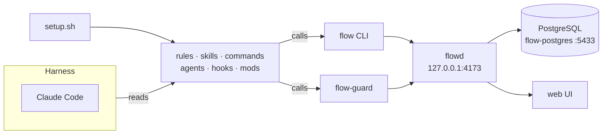
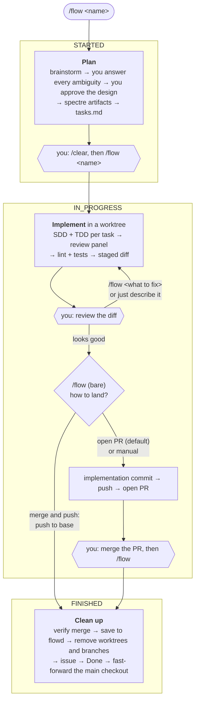

# agents

Portable, project-agnostic agent configuration: the **flow** pipeline (spectre + Superpowers), its
skills and slash commands, always-on rules, hooks, and the stats service that records every run.

**This repository is the source of truth — edit here, run `./setup.sh global`.** Nothing is ever
synced *into* this repo from a project checkout.

---

## Quick start

```bash
./setup.sh global                                          # install into ~/.claude
go install github.com/tweety53/spectre/cmd/spectre@latest  # needed by every skill but /flow-plan
cd stats && docker compose up -d && make build              # flowd + flow CLI (see Stats app)
```

- In Claude Code, install Superpowers: `/plugin install prime-radiant-inc/superpowers`.
- Register the hooks the installer prints into `~/.claude/settings.json`, then type `/flow <name>`
  in any project.

---

## Architecture

**`setup.sh` installs; the harness reads; every check and record goes through `flowd`.**



---

## Repository layout

```text
.
├── .flow/            this repository's own flow config (project.md: lint, test, run, stop)
├── agents/           subagent definitions: flow-{low,medium,high,xhigh}, flow-planner-{low,medium,high,xhigh}; the
                  non-planner types compact at 150,000 tokens (`autoCompactWindow`), which a
                  `CLAUDE_CODE_AUTO_COMPACT_WINDOW` in the environment overrides — set the session's window with
                  the `autoCompactWindow` setting instead
├── commands-claude/  thin slash-command wrappers for Claude Code
├── docs/             briefs/ (lessons), designs/ (the design record run 1 writes per /flow change) and prompt-tuning/ (/flow-prompt-tuning inbox + LEDGER.md)
├── hooks/            the Python hooks (see Guardrails)
├── mods/             Claude Code plugins: flow-task-list (the task band above the prompt)
├── rules/            rules (alwaysApply in each frontmatter) + agent-baseline.md, the subagent baseline
├── scripts/          flow-guard, the bootstrap that builds and runs every guard
├── skills/           the /flow* skills; flow-contracts/ holds the on-demand contracts (map: skills/README.md)
├── spectre/          peers (cross-repo links); changes/ is gitignored, per change
├── stats/            flowd, the flow CLI, every guard (internal/guard/) and the web UI (web/)
├── templates/        CLAUDE.md copied into a project that lacks one
├── setup.sh          the installer
└── CLAUDE.md         this repository's instructions (Claude Code)
```

- **`rules/`:** whether a rule is always-on is its own `alwaysApply`; opt-in rules (e.g. the Kotlin
  backend standard) reach only projects that name them.
- **`skills/flow-contracts/pipeline.md`** is canonical for the state machine.
- **`mods/flow-task-list`** shows the main agent's unit, each running subagent as `Task <x>/<n>`,
  and the plan's pending tasks; its hint line adds the tracker key, phase and done/total count.

---

## Commands

**`<name>` is optional everywhere** — with one open change it is picked, otherwise you are asked.
No command takes a flag.

| Command | What it does |
|---------|--------------|
| `/flow <name>` | The whole pipeline, one command, re-entrant — see below |
| `/flow-fast <name>` | Lighter: worktree, plan-check-decided implementation and panel, lint + targeted tests, default landing route, cleanup. No spectre artifacts or state file |
| `/flow-interactive [key or name]` | Conversational session: each request is implemented inline, verified, landed by merge and push (`flow interactive land`); an explicit stop self-reviews, cleans up and finishes |
| `/flow-plan` | Thinking-partner mode, no implementation; a captured session creates the change at `STARTED` |
| `/flow-status [name]` | Read-only report of every open change |
| `/flow-self-review <name>` | Runs the self-review pass an older run deferred |
| `/flow-prompt-tuning` | Applies saved implementer/reviewer prompt updates after a replay proves each; logs to `docs/prompt-tuning/LEDGER.md` |
| `/flow-visual-tooling-analysis` | Works out why a visual verification missed a defect and writes the sweeps that close its class |
| `/flow-learn-quiz` | Teacher mode: has you restate a change and quizzes you until you understand it |
| `/call-efficiency-audit` | Measures a running dev stack's repeated reads, repeated queries and per-item queries |

## How the pipeline works

Three states. Every arrow into a box is a `/flow` invocation, and every hexagon is a gate that is
yours.



- **The gate is the state.** No command exists just to record that you reviewed something.
- **A fix never moves the state.** Re-run `/flow` with instructions, or describe the problem in the
  same session.
- **Merge status alone decides** whether a bare `/flow` integrates or cleans up.
- **Run 2 runs no tests or linters** and commits nothing: it saves `tasks.md` and the self-review
  bundle to flowd, then removes the worktrees.
- **The plan is read cold before it is implemented.** On a change that is not trivial, a fresh
  headless pass reads the artifacts — and nothing of the conversation — once, after the plan is written
  (`flow-guard plan-check`). The planner fixes, contests
  or escalates each finding; the lenses are `skills/flow/plan-review-rubric.md`.
- **The design outlives the change.** Run 1 commits the change's `design.md` as
  `docs/designs/<name>.md` inside the implementation commit, a point-in-time record nothing keeps
  current.

Canonical detail: **State transitions** (`skills/flow-contracts/pipeline.md`), and
`skills/flow-contracts/finish-contract-run1.md` / `finish-contract-run2.md` for landing and cleanup.

### Deciding how to implement (plan check)

**A headless plan check (`scripts/flow-guard plan-check`) decides the implementer groups, the review panel and visual
verification; every dispatch runs on its role's pair from `scripts/flow-guard pair-judge`; nothing in
a project configures them.** The run prints a `## Decision` block and proceeds without asking.

- **Groups.** One implementer dispatch per group: a `**Size:** big` task alone, any other group at
  most three tasks, never two repositories. Every group gets the gated per-task reviewer once its
  tasks pass `close-task`.
- **Panel.** `primary` always runs; `principles`, `test-sanity`, `call-efficiency`,
  `failure-modes` and `mutation` run only when the change gives them something to read. A bundle
  holds one or two reviewers, `mutation` always alone. A fix round re-runs only the roles that
  raised a finding.
- **Visual.** `required`, `skipped` or `not configured`.
- Saved to `.superpowers/sdd/decision.json` and `flowd`.

Canonical: **Plan check gate** and **Model and effort** (`skills/flow/brainstorm-planner.md`), and
`skills/flow/plan-check-prompt.md`.

### Level 1 — the stages of each command

Every stage a run marks in `flowd`. `stats/internal/stages/names_test.go` parses this table and
fails if it drifts from the code, so edit both together. `/flow-status` marks nothing; which phase
file marks each key is **Stage keys** (`skills/flow/stage-keys.md`).

| Key | Name | Commands |
|-----|------|----------|
| `flow.plan` | Plan — kickoff to the plan gate | `/flow`, `/flow-fast`, `/flow-interactive`, `/flow-plan` |
| `flow.implement` | Implement | `/flow`, `/flow-fast`, `/flow-interactive` |
| `flow.review` | Review | `/flow`, `/flow-fast` |
| `flow.verify` | Verify: workspace isolation, lint and test | `/flow`, `/flow-fast`, `/flow-interactive` |
| `flow.land` | Land | `/flow`, `/flow-fast`, `/flow-interactive` |
| `flow.self-review` | Run the self-review pass (run 1) | `/flow`, `/flow-fast`, `/flow-interactive` |
| `flow.pipeline-fix` | Pipeline fix — a fix to the flow tooling a run makes | `/flow`, `/flow-fast` |
| `flow.cleanup` | Cleanup (run 2) ▸ | `/flow`, `/flow-fast`, `/flow-interactive` |
| `plan.session` | Plan session — `/flow-plan` research up to a capture's kickoff | `/flow-plan` |

▸ marks a stage with substructure; its procedure lives in the phase file under `skills/flow/`.

---

## Guardrails

**The pipeline never relies on an agent saying it behaved.** Each check is Go in
`stats/internal/guard/` with its test beside it; `go test ./internal/guard/...` from `stats/` runs
them all. `.flow/project.md` `## lint` lists this repository's own.

**Hooks, always on:**
- `enforce-agent-baseline.py` — denies a dispatch missing the `agent-baseline.md` pointer, a fork
  in a flow session, or a loop-keyed dispatch with no `Key:` line, and begins the dispatch's row
  (`stats/internal/repotest/enforce_agent_baseline_hook_test.go`).
- `enforce-loop-dispatch.py` — records a pipeline-fix or self-review loop dispatch
  (`scripts/flow-guard check-loop-dispatch`).
- `block-unsafe-commands.py` — denies edits, staging, commits, stashes and resets on a main
  checkout's default branch.
- `flow-active-change.py` — routes a plain problem report to the open change as a fix run, or to an
  unfinished `/flow-interactive` session as its next request or stop.
- `await-own-agents.py` — blocks a subagent's stop while an agent it launched still runs, so it
  waits inside its prompt-cache window.
- `flow-session-activity.py` — reports each session's working/waiting state to `flowd` for the
  state board.

**Implement:** `prepare-workspace` (validates the isolation table; own database, cache, bucket, ports).

**Verify:** `run-verify-list` (the lint and test lists, the visual `verify` row last; the test list is the default run, and `-full` — every skip off, run only when the operator asks, refused without the operator's `FLOW_OPERATOR_FULL_SUITE=1` — is the full suite; `-only <visual-failing.txt>` re-runs only the failing ones, once with one retry, a retry-pass reported flaky, each round's log kept as `visual-<mode>-r<N>.log`, and one plain run is the gate), `visual-verify-pass` (the parent's side of `flow.visual-verify`; a scoped fix round whose every frame was re-captured and whose every changed frame was judged closes the visual loop with no `-full` run, and an unscoped single-worktree pass over more than 25 frames runs as up to four verifier shards at once), `smoke-keep` (the heavy tests a touched file keeps in the default run), `test-cost` (each test's cost from the test2json it reads on stdin, for re-profiling the heavy marks); `flow suite list -tests <suite>` prints a suite's recorded per-test costs.

**Review panel:** `run-reproducer` (a reviewer's command, run in a capped throwaway copy),
`break-and-prove` (the `mutation` role).

**Land and clean up:** `integrate-change` (every mechanical step, in four calls),
`check-finish-preflight` (integrate vs cleanup from merge state), `check-unfinished-work`.

**This repository's lint** adds `check-references` (every ``**Section** (`file`)`` citation
resolves).

---

## Stats app (`stats/`)

**`flowd` on `127.0.0.1:4173`, PostgreSQL behind it (`flow-postgres`, port 5433), is the store
every `/flow*` command writes through the `flow` CLI.**

- **State** — each change's state, worktrees and PR (`flow state`); when the daemon is down, writes
  go to an on-disk journal and replay later (`flow journal`).
- **Stages and cost** — `flow stage begin/end` marks every Level 1 stage; every 5 s `flowd` assigns
  transcript tokens to the running stage at published per-model rates (no rate: *unavailable*,
  never estimated).
- **Records** — findings, verdicts, dispatches, decisions, incidents
  (`flow record`); the guards read these, not Markdown.
- **Jira** — forward-only transitions with retries (`flow jira transition`); off until the three
  `FLOWD_JIRA_*` variables are set.

**Web UI** at http://127.0.0.1:4173, filterable by project, period and model (`stats/web/src/views/`):
- state board, stage leaderboard, cost and token trend, weekly costs
- reviewers, reviewer findings, role costs, agent roles
- self-review, flow health (which guards fire, which never fire, and what they cost in run time), run detail

Run detail's **Timings and costs →** opens that run's own page (`#/run-costs/<project>/<change>`):
totals, a group-by breakdown, counts, cost per group and per verify round, and a data-quality
panel; every metric states its definition and whether it is measured, derived or estimated.

```bash
cd stats && docker compose up -d   # PostgreSQL
make build                          # flowd + flow CLI (builds the SPA first)
```

- `stats/README.md` covers the launchd agent, the UI-test stack on port 4174, Jira credentials and
  checking token attribution by hand.
- **Never stop the live daemon or drop the `flow` database:** every project's runs write to it.

---

## Installation

### Global (recommended)

```bash
./setup.sh global
```

Symlinks skills, commands, agents, hooks and full-text rules into `~/.claude/`, each
`mods/<name>/` into `~/.claude/skills/` (auto-loaded as a plugin), and writes the always-on rules'
managed block into `~/.claude/CLAUDE.md`.

- **Edits to existing skills, commands and hooks are live** (symlinks); re-run only when a file is
  added or removed.
- **Edits to an always-on rule need a re-run.** The managed block carries rendered text (`<!-- core
  -->` plus a `Full rule:` pointer); only the text between `<!-- flow:begin -->` / `<!-- flow:end
  -->` is rewritten.
- **Hooks are installed, never registered.** The installer prints the `settings.json` snippet; the
  paste is yours.
- **Every dispatch points at `~/.claude/rules/agent-baseline.md`** — whether a subagent reads
  `CLAUDE.md` varies by harness and agent type; `enforce-agent-baseline.py` denies one that does not.

### Per project

```bash
cd /path/to/project
/path/to/agents/setup.sh claude-code
```

- Links skills, commands and agents into `.claude/`.
- **The only way an opt-in rule reaches a project:** reads `## standards` in
  `<project>/.flow/project.md` and renders those `rules/*.mdc` into a managed block in
  `<project>/CLAUDE.md`. Re-run after editing an opt-in rule.

### Claude Code

- Install Superpowers: `/plugin install prime-radiant-inc/superpowers`.
- **The `commands-claude/` wrappers are required** — without them `/flow` fails with "Unknown
  command"; Claude Code finds skills by name, not by slash alias.

